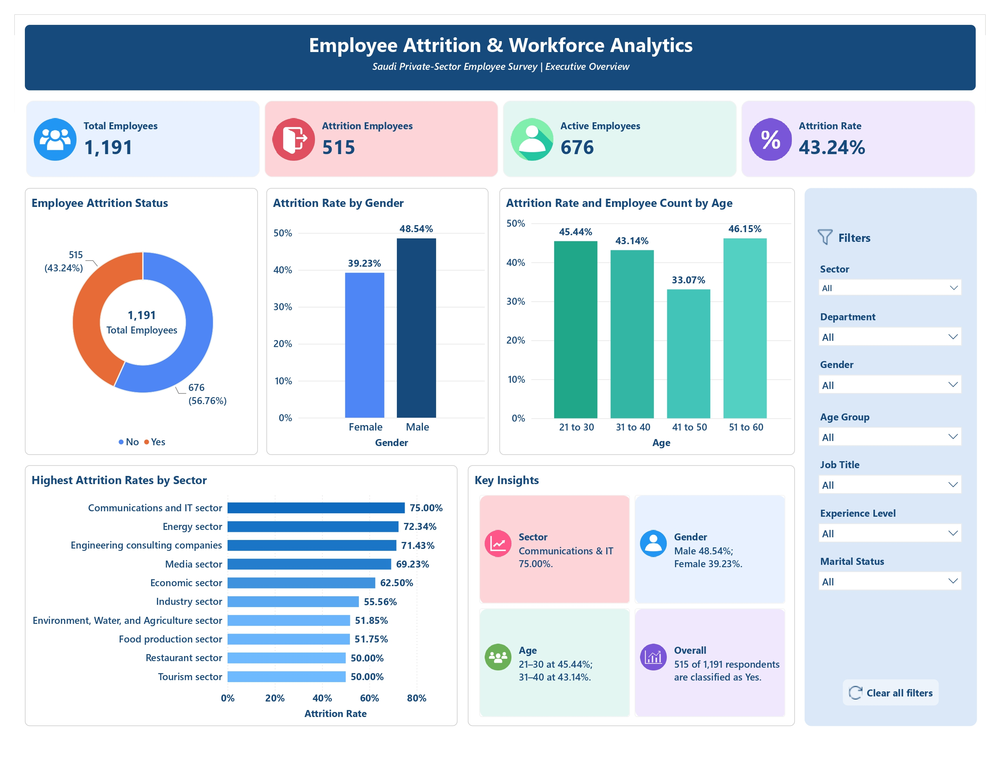
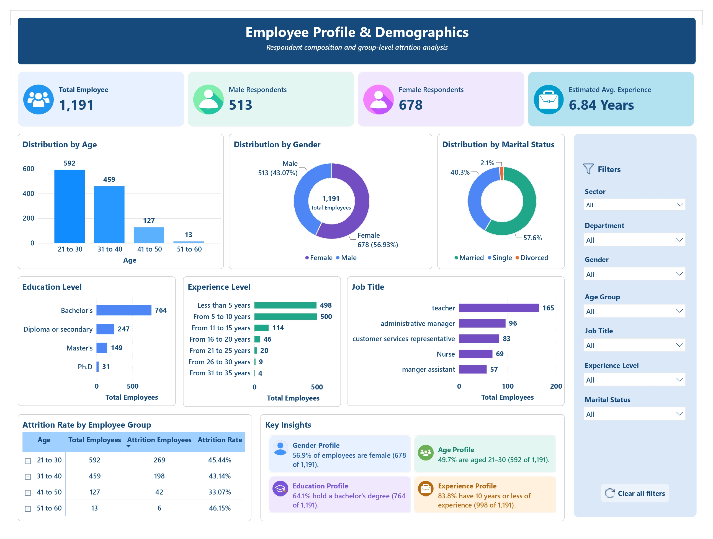
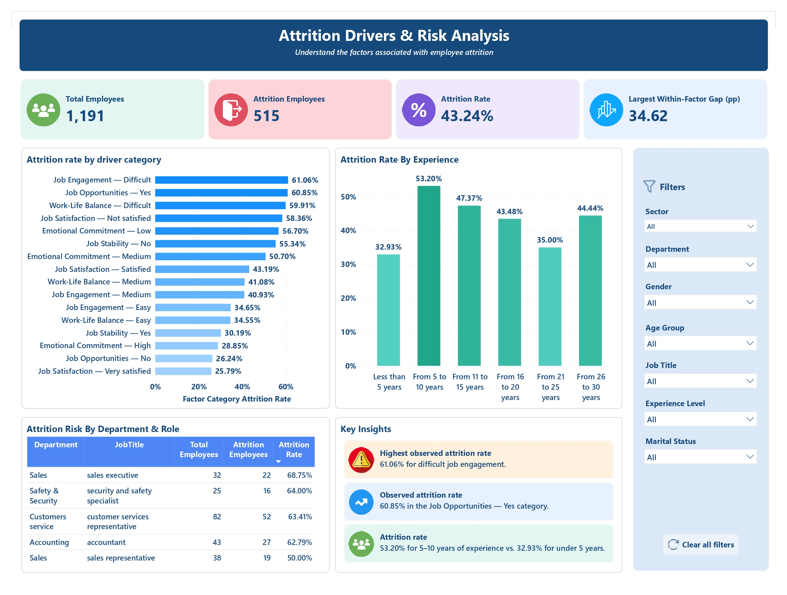

# HR Attrition Analytics | Python, SQL & Power BI

An end-to-end data analytics project exploring employee attrition patterns, workforce demographics, and potential attrition risk factors using Python, SQL, and Power BI.

> **Portfolio project:** Descriptive workforce analytics using the Saudi Employee Attrition Dataset. The findings describe patterns in the analyzed survey data; they do not establish causation.

## Project Overview

Employee attrition can affect workforce stability, employee experience, and organizational continuity. This project analyzes employee survey data to understand attrition patterns across job-related, demographic, and employee-experience categories.

The workflow covers data understanding, data cleaning, exploratory data analysis, SQL-based analysis, and interactive Power BI dashboard development.

- **Project type:** End-to-end Data Analytics
- **Domain:** Human Resources / Workforce Analytics
- **Tools:** Python, Pandas, SQL, Power BI, DAX, Power Query, Excel
- **Records analyzed:** 1,191

## Business Objectives

- Measure overall employee attrition and the active workforce.
- Explore workforce demographics and job-title distributions.
- Compare observed attrition rates across job-related and employee-experience categories.
- Identify categories with comparatively high attrition rates for further investigation.
- Present findings through an interactive, multi-page Power BI dashboard.
- Translate analytical findings into practical HR recommendations.

## Dataset

This project uses the **Saudi Employee Attrition Dataset**, published on Mendeley Data.

- **Dataset:** [Saudi Employee Attrition Dataset](https://data.mendeley.com/datasets/6z2hty8php/1)
- **DOI:** [10.17632/6z2hty8php.1](https://doi.org/10.17632/6z2hty8php.1)
- **Population:** Survey participants working in Saudi Arabia's private sector
- **Records analyzed:** 1,191
- **Attributes described by the source:** 34
- **Collection method:** Online survey

The source record includes the original dataset, alternative preprocessed dataset files, survey questions, and variable-coding documentation. This project uses the original dataset as the starting point for its own cleaning and analysis workflow.

## Tools & Technologies

| Tool | Purpose |
|---|---|
| Python | Data understanding, cleaning, and exploratory analysis |
| Pandas | Data manipulation and validation |
| SQL | Structured querying and analytical exploration |
| Power BI | Interactive dashboard development |
| DAX | KPI calculations and attrition-rate measures |
| Power Query | Data transformation and preparation |
| Excel | Source-data inspection and supporting documentation |

## Project Workflow

### 1. Data Understanding
- Inspected the original dataset and its structure.
- Reviewed variable definitions and survey questions.
- Examined data types, categories, and the attrition target.
- Identified dimensions relevant to workforce and attrition analysis.

### 2. Data Cleaning — Python
- Prepared the dataset for analysis.
- Reviewed data quality and field consistency.
- Standardized relevant columns and category values as required.
- Exported the cleaned dataset for subsequent analysis.

### 3. Exploratory Data Analysis — Python
- Examined workforce and attrition distributions.
- Explored patterns across demographic and job-related variables.
- Reviewed employee satisfaction, engagement, and experience categories.
- Identified areas for further analysis in SQL and Power BI.

### 4. SQL Analysis
Used SQL queries to support structured data exploration and attrition analysis. The SQL component complements the Python workflow and Power BI reporting.

### 5. Power BI Dashboard
Developed a three-page interactive dashboard with KPI cards, charts, filters, and category comparisons.

## Dashboard Pages

### Page 1 — Employee Attrition & Workforce Analytics

Provides a high-level overview of the workforce and overall attrition.

**Key metrics:** Total Employees, Attrition Employees, Active Employees, and Attrition Rate.

**Purpose:** Establish the overall workforce baseline and summarize attrition. The sector chart includes employee counts in its tooltips so viewers can interpret rates in the context of sector workforce size.

### Page 2 — Employee Profile & Demographics

Explores workforce composition and employee distribution.

**Key analyses:** employee distribution by gender, job title, and experience, with interactive filtering.

**Purpose:** Understand workforce composition and how employees are distributed across roles and demographic categories.

### Page 3 — Attrition Drivers & Risk Analysis

Examines observed attrition-rate differences across selected job-related and employee-experience categories.

**Key analyses:** attrition rate by driver category and experience band, highest observed category-level rates, department and job-title comparisons, and key findings.

**Purpose:** Highlight categories that warrant further investigation and guide evidence-informed retention discussions.

## Key Findings

The validated Power BI report shows the following results:

| Metric / Category | Result |
|---|---:|
| Total employees analyzed | 1,191 |
| Attrition employees | 515 |
| Active employees | 676 |
| Overall attrition rate | 43.24% |
| Job Engagement — Difficult | 61.06% |
| Job Opportunities — Yes | 60.85% |
| Work-Life Balance — Difficult | 59.91% |
| Job Satisfaction — Not satisfied | 58.36% |
| Emotional Commitment — Low | 56.70% |
| Job Stability — No | 55.34% |
| Experience band — 5–10 years | 53.20% |

These results describe the dataset analyzed in this project. They do not establish that a particular category causes employee attrition. Category definitions and the meaning of individual survey responses should be considered when interpreting the findings.

## Business Recommendations

1. **Review employee engagement:** Explore why employees in the difficult job-engagement category show a comparatively high attrition rate.
2. **Investigate work-life balance:** Review workload, scheduling, and employee feedback across response categories.
3. **Assess job satisfaction:** Conduct structured feedback discussions and examine potential differences in employee experience.
4. **Understand mid-career retention:** Investigate the higher observed attrition rate in the 5–10 years experience band.
5. **Review role-level patterns:** Compare attrition rates alongside employee counts so small groups do not dominate decisions.
6. **Validate before intervening:** Combine descriptive results with additional organizational evidence before implementing retention initiatives.

These are exploratory recommendations, not causal conclusions. Any HR intervention should be evaluated using appropriate organizational data and employee feedback.

## Repository Structure

The structure below documents the intended organization. Make sure filenames match the files actually committed to the repository.

```text
HR-Attrition-Analytics/
├── README.md
├── requirements.txt
├── .gitignore
├── 01_Raw_Data/
│   ├── Dataset Keys.doc
│   ├── Online Survey Questions.doc
│   └── Original Dataset of Employee Attrition.xlsx
├── 02_Cleaned_Data/
│   └── employee_attrition_clean.csv
├── 03_Python/
│   ├── 01_Data_Understanding.py
│   ├── 02_Data_Cleaning.py
│   └── 03_Exploratory_Data_Analysis.py
├── 04_SQL/
│   └── HR_Attrition_Analytics.sql
├── 05_PowerBI/
│   └── HR_Attrition_Analytics.pbix
└── 06_Documentation/
    ├── HR Business Recommendations.md
    └── screenshots/
        ├── Executive_Overview.jpg
        ├── Employee_Profile.jpg
        └── Attrition_Drivers.jpg
```

Do not commit confidential or licensed source data unless you have confirmed redistribution is permitted. If source files are not included in the public repository, explain how to obtain them from the original source.

## How to Explore the Project

1. Clone or download this repository.
2. Review the dataset documentation and data dictionary.
3. Inspect the Python scripts in sequence:
   - `03_Python/01_Data_Understanding.py`
   - `03_Python/02_Data_Cleaning.py`
   - `03_Python/03_Exploratory_Data_Analysis.py`
4. Review the SQL analysis in `04_SQL/`.
5. Open `05_PowerBI/HR_Attrition_Analytics.pbix` using Power BI Desktop.

Python dependencies and database configuration may need to be installed or adjusted for your environment. Update `requirements.txt` to reflect the imports used by the final Python scripts, and add database setup instructions if the SQL workflow requires a specific server or database.

## Limitations

- The dataset is based on survey responses from employees in Saudi Arabia's private sector and may not represent all employees or organizations.
- Self-reported survey data may contain response bias.
- The analysis is descriptive and does not establish causation.
- The meaning of individual response categories should be confirmed against the source documentation.
- Results may not generalize to other countries, industries, or organizations.

## Data Source & Attribution

Alqahtani, H., Almagrabi, H., & Alharbi, A. (2025). *Saudi Employee Attrition Dataset* (Version 1). Mendeley Data. [https://doi.org/10.17632/6z2hty8php.1](https://doi.org/10.17632/6z2hty8php.1)

The dataset is described as distributed under the **Creative Commons Attribution 4.0 International (CC BY 4.0)** license. Retain appropriate attribution and verify the license terms on the source record before redistributing dataset files.

## Author

**Prasobh R.**

Data Analytics | Python | SQL | Power BI

- GitHub: [prasobh-r](https://github.com/prasobh-r)
- LinkedIn: [prasobh04](https://linkedin.com/in/prasobh04)
- Portfolio: [prasobh-r.github.io/portfolio-website](https://prasobh-r.github.io/portfolio-website/)

---

*This project was developed for data analytics practice and portfolio demonstration.*
