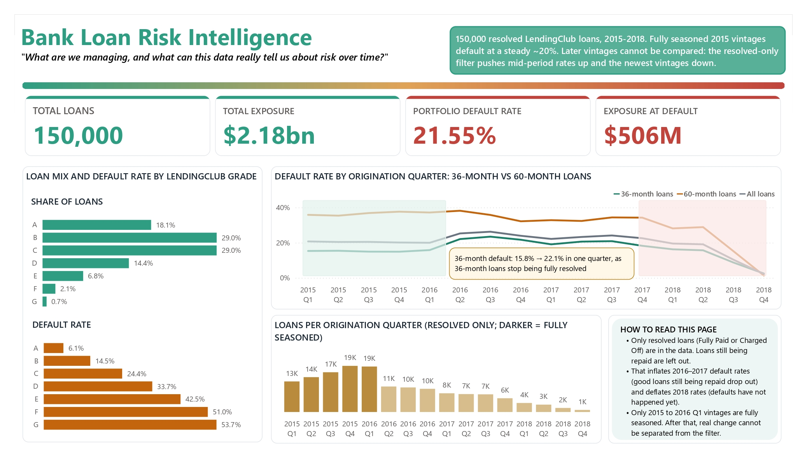
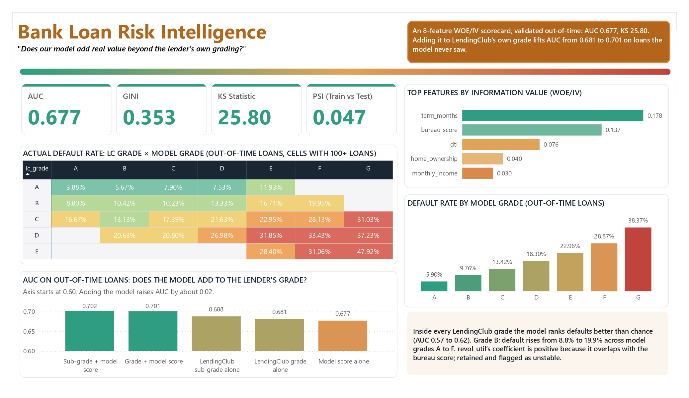
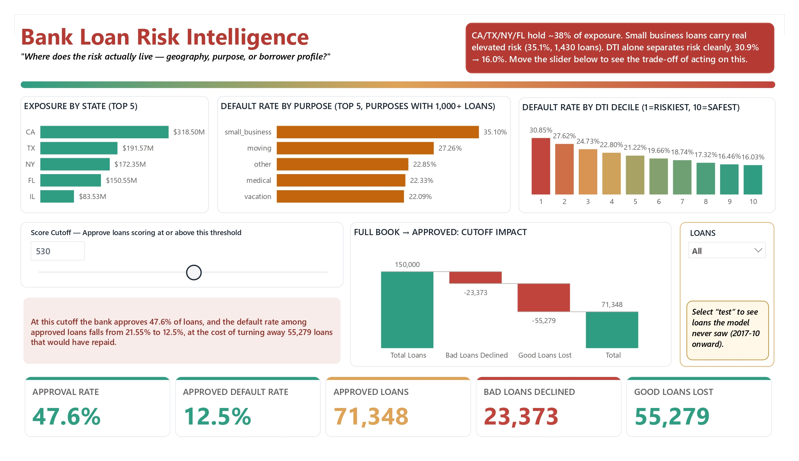

# Bank Risk Intelligence

An end-to-end credit risk analytics project on real LendingClub loan data —
covering data engineering, an independently-built credit scorecard, and a
3-page Power BI decision-support dashboard with a live approval-cutoff
simulator. Built across Python, SQL Server, and Power BI.



---

## Why this project is different from a typical "beginner" loan-risk project

Most portfolio loan-risk projects stop at "trained a logistic regression, got
an AUC." This one is built around the actual vocabulary and workflow of a
credit risk analyst, on real data rather than a synthetic toy dataset:

- **Real data** — a random sample of 150,000 resolved LendingClub loans
  (2015–2018), not a fabricated dataset with no external benchmark
- A **credit scorecard** built with Weight of Evidence (WOE) binning and
  Information Value (IV) — the industry-standard technique real credit risk
  teams use, not a black-box classifier
- **KS statistic, Gini coefficient, and PSI** reported alongside AUC — the
  metrics a risk committee actually expects
- **Benchmarked against a real lender's own grading** — LendingClub's A–G
  grade is used as an external check on the model, not just an internal
  train/test split
- **Out-of-time validation** — trained on the 2015-01 to 2017-09 vintages
  (134,913 loans), tested on 2017-10 to 2018-12 (15,087 loans), with the WOE
  bins fitted on the training vintages only
- **Every honest limitation documented, not hidden** — a leakage risk caught
  and removed, a sign-flipped coefficient flagged rather than deleted, an
  immature-vintage bias called out explicitly, and a modest gain over the
  lender's own grade reported as modest

---

## Business Problem

A consumer lending analytics team needs to answer three questions that most
single-page projects collapse into one:

1. **What are we managing, and how has portfolio risk moved over time?**
   Understanding the book's scale and trend — including where a naive read
   of that trend would be *wrong* — before drawing any conclusions from it.
2. **Did we build a model that adds real value?** Not just "trained a
   model," but validated it out-of-time and proven it discriminates risk
   beyond what the original lender's own underwriting already captured.
3. **Where does risk concentrate, and what should we actually do about it?**
   Segmentation that flows into an actionable decision tool, not just
   descriptive charts.

This project builds a full pipeline — raw CSV → Python cleaning and
scorecard modeling → SQL Server star schema and analytical queries → a
3-page Power BI dashboard — to answer all three.

---

## Architecture

```
Raw LendingClub CSV (accepted_2007_to_2018Q4.csv, via Kaggle)
        │
        ▼
Python (pandas, scikit-learn) — cleaning, WOE/IV feature binning,
                                 logistic regression scorecard,
                                 out-of-time KS / Gini / AUC / PSI evaluation
        │
        ▼
SQL Server — star-schema database, vintage analysis, grade-benchmark
             comparison, geographic/purpose/DTI segmentation queries
        │
        ▼
Power BI — 3-page dashboard: portfolio trajectory, scorecard validation,
           segmentation + live approval-cutoff simulator
        │
        ▼
Business recommendations
```

---

## Dataset

**Real data:** [LendingClub accepted loans, 2007–2018](https://www.kaggle.com/datasets/wordsforthewise/lending-club)
(via Kaggle) — filtered to resolved loans (Fully Paid or Charged Off) from
2015 onward to support a clean binary target, then a random sample of
150,000 loans (seed 42) for a tractable analysis scope. See `Documentation/dataset_guide.md` for the full column mapping and
download steps.

| Field group | Source columns |
|---|---|
| Loan terms | `loan_amnt`, `term`, `int_rate`, `installment`, `purpose` |
| Borrower profile | `annual_inc`, `emp_length`, `home_ownership`, `addr_state`, `dti`, `revol_util` |
| Bureau-style signal | `fico_range_low/high`, `delinq_2yrs`, `inq_last_6mths`, `open_acc` |
| Ground truth | `loan_status` → `defaulted` |
| Benchmark | `grade`, `sub_grade` — LendingClub's own A–G scorecard |

**Known limitations, documented rather than hidden:**
- LendingClub doesn't disclose borrower age
- No full month-by-month repayment ledger — only current status and
  last-payment snapshot fields
- Filtering to *resolved* loans only means recent vintages (2017–2018)
  appear artificially safer than they truly are — real loans still heading
  toward default haven't resolved yet in this extract (see Key Insight)
- The out-of-time test set (2017-10 to 2018-12) is the most immature part of
  the data: its default rate is 18.6% against 21.9% in training, partly because
  recent loans have not had time to default

---

## What I Built

### Python — Data Engineering & Credit Scorecard
- Cleaned and validated the real LendingClub extract — duplicate checks and
  missing-value handling
- **WOE/IV feature binning**: ranked 13 candidate features by Information
  Value (fitted on the training vintages only) and kept the 8 with IV ≥ 0.02,
  deliberately **excluding `int_rate`/`grade`/`sub_grade`** — these are
  LendingClub's own risk-based outputs, and including them would leak the
  answer rather than test an independent model
- Trained a **logistic regression scorecard** on the WOE-transformed
  features, validated **out-of-time** (train: 2015-01 to 2017-09 vintages,
  test: 2017-10 to 2018-12)
- Converted output probabilities into a points-to-double-odds score (observed
  range 453–591, not a full 300–850 spread) and an A–G risk grade
- Reported **AUC, KS, Gini, and PSI together** — not AUC alone
- Tested whether the model adds anything **beyond LendingClub's own grade**:
  AUC of the grade alone against grade plus model score, on the test vintages
- Flagged a sign-flipped coefficient (`revol_util`, partly redundant with the
  bureau score) rather than silently trusting the model

### SQL Server — Portfolio Analytics Layer
Star-schema database (`Dim_Borrower`, `Fact_Loan`) with queries covering:
- Vintage analysis — default rate by origination month
- **Model grade vs. LendingClub's real grade** — a cross-tab comparison most
  portfolio projects never get to make, shown for all loans (in-sample for
  about 90% of them) and for the out-of-time test vintages only, with loan
  counts per cell
- Geographic concentration, purpose-level risk and pricing, DTI risk
  deciles via `NTILE()` with a deterministic tie-breaker
- A reusable view (`vw_PortfolioRiskSummary`) feeding Power BI directly

See `SQL/01_Database_Setup_LendingClub.sql` (schema),
`SQL/03_Load_Model_Scores.sql` (loads the scorecard output) and
`SQL/02_Analysis_Queries_LendingClub.sql`.

### Power BI — 3-Page Interactive Dashboard

**1. Portfolio & Trajectory** — headline KPIs (total loans, exposure,
default rate), loan mix and default rate by LendingClub grade, and the default
rate by origination quarter split into 36-month and 60-month loans. The split
shows where the resolved-loans-only filter starts to distort the trend, and a
"how to read this page" note says which vintages can be compared and which
cannot, rather than reporting the raw trend at face value.


**2. The Scorecard: Built, Validated, Benchmarked** — the WOE/IV feature
ranking, AUC/KS/Gini/PSI, and a grade-comparison matrix of LendingClub grade
against model grade on the out-of-time loans, showing where the model's risk
ranking agrees with the lender's and where it adds information. Cells with
fewer than 100 loans are masked.



**3. Segmentation & the Decision** — geographic, purpose, and DTI-decile
risk concentration, flowing directly into a **live What-If score-cutoff
simulator**: drag a slider and watch approval rate, approved default rate,
correctly-declined bad loans, and lost good loans update in real time,
alongside a fixed reference table and a waterfall chart showing the full
book's flow down to the approved subset.



---

## Key Insight: Risk Is Spread Thin, and an Independent Model Adds a Modest but Real Gain on Top of a Real Lender's Own Grade

13 candidate features were ranked by Information Value on the training
vintages only. The 8 with IV ≥ 0.02 went into a WOE logistic regression
scorecard, validated out-of-time.

**Feature strength (Information Value, training vintages):**

| Feature | IV | Strength |
|---|---|---|
| term_months | 0.178 | Medium |
| bureau_score | 0.137 | Medium |
| dti | 0.076 | Weak |
| home_ownership | 0.040 | Weak |
| monthly_income | 0.030 | Weak |
| loan_amnt | 0.030 | Weak |
| revol_util | 0.030 | Weak |
| inq_last_6mths | 0.025 | Weak |

Nothing clears "Strong". The loan term and the bureau score are the only
"Medium" signals: 60-month loans default at 34.9% against 17.5% for 36-month
loans. Risk is spread across several weak-to-medium signals rather than one
dominant driver, which is why real scorecards combine 8–15 features.
`purpose` (IV 0.0199) fell just below the 0.02 cut-off and was not used.

**Model performance (out-of-time test set, 15,087 loans):**

| Metric | Value |
|---|---|
| AUC | 0.677 |
| Gini | 0.353 |
| KS | 25.80 (Acceptable) |
| PSI (train vs. test) | 0.047 (no significant population shift) |

**Benchmarked against a real lender's own grade (same out-of-time loans):**

| Predictor | AUC |
|---|---|
| Model score alone | 0.677 |
| LendingClub grade alone (A–G) | 0.681 |
| LendingClub sub-grade alone (35 levels) | 0.688 |
| Grade + model score | 0.701 (+0.020) |
| Sub-grade + model score | 0.702 (+0.014) |

On its own the model ranks defaults slightly worse than LendingClub's grade,
which reflects the lender's own underwriting. Adding the model score to the
grade raises AUC by 0.020 (0.014 against the sub-grade): a small but real
amount of information the lender's grade does not already capture.

Within each of the seven LendingClub grades the model ranks defaults better
than chance (AUC 0.57 to 0.62); grades F and G have only 188 and 71 test
loans, so those two are less certain. For example, inside LendingClub
Grade B (341 to 945 loans per cell) the default rate rises from 8.8% for
model grade A to 19.9% for model grade F, with one small reversal between
model grades B and C (10.4% vs 10.2%). Across all test loans, model grades
A to G default at 5.9%, 9.8%, 13.4%, 18.3%, 23.0%, 28.9% and 38.4%.

**One anomaly, documented rather than hidden:** the `revol_util` coefficient
is positive (+0.14) where every other feature is negative. It is partly
redundant with the bureau score (correlation of their WOE values 0.48), so
once the bureau score is in the model it adds little independent signal.
Variance inflation factors are all below 1.5, so this is not severe
multicollinearity. Retained for completeness, flagged as unstable.

**One data-honesty catch on the trend side:** the data holds resolved loans
only (Fully Paid or Charged Off), and that filter distorts the vintage
default-rate trend in two directions. Loans still being repaid are left out,
and they are mostly good loans, so default rates for the 2016–2017 vintages are
pushed up. The newest vintages have not had time to default yet, so 2018 rates
are pushed down. Splitting by loan term shows the first effect: the default rate
of 36-month loans is steady at 15% to 16% through 2016 Q1 (the last quarter
whose 36-month loans are fully resolved), then jumps to 22% in 2016 Q2, while
60-month loans show no such jump. Only the 2015 to 2016 Q1 vintages are fully
seasoned, at a stable ~20%. After that, any real change in loan quality cannot
be separated from the filter with this data. The out-of-time test set is also
the most immature part of the data, so its 18.6% default rate is lower than
the 21.9% seen in training.

**Business implication:** because no single feature dominates and the model
adds a modest gain over the lender's own grade, a "one-lever fix" approach to
underwriting won't meaningfully sharpen approval decisions on its own. This
is reflected directly in the dashboard's third page: segmentation
(geography, purpose, DTI) combined with a live cutoff simulator, rather than
a single blanket threshold recommendation.

---

## Results

- **150,000** real LendingClub loans (2015–2018 vintages, resolved outcomes
  only) analyzed end-to-end from raw CSV to a risk-scored, benchmarked
  portfolio
- **21.55%** overall default rate in the analysis set (elevated relative to
  a live book, since filtering to resolved loans excludes many still-current,
  generally safer, more recent loans — a documented artifact, not an error)
- **CA, TX, NY, FL together hold ~38%** of total portfolio exposure
- **Small business loans carry a genuinely elevated 35.1% default rate** on
  a real 1,430-loan sample — the highest of any purpose category with a
  trustworthy sample size
- **DTI risk decile alone** separates default rate cleanly from 30.9%
  (riskiest) to 16.0% (safest)
- Built an independent 8-feature WOE/IV credit scorecard achieving
  **AUC 0.677 / KS 25.80** out-of-time, with model grades A to G defaulting
  at 5.9% to 38.4% on the test loans
- **Benchmarked the scorecard against LendingClub's own real grade** — adding
  the model score to the lender's grade lifts out-of-time AUC from 0.681 to
  0.701, and the model ranks defaults better than chance inside every
  LendingClub grade (AUC 0.57 to 0.62)
- **PSI of 0.047** shows no significant population shift between the
  2015–2017 training vintages and the 2017–2018 test vintages
- Built a live Power BI score-cutoff simulator showing the real trade-off
  between bad loans correctly declined and good loans lost at any threshold

---

## Tech Stack

Python (pandas, scikit-learn) · SQL Server (T-SQL, CTEs, window functions,
views) · Power BI (DAX, What-If parameters, conditional formatting) ·
Jupyter Notebook

---

## How to Reproduce

1. Download the raw LendingClub file from Kaggle (see
   `Documentation/dataset_guide.md`) and run notebooks 01 and 02 in `Python/`.
   They read the raw file from a path set at the top of each notebook; edit it
   to your location.
2. Run `03_woe_iv_binning.ipynb`, then `04_scorecard_model_and_evaluation.ipynb`,
   from the `Python/` folder. They write `Dataset/loans_woe_transformed.csv`,
   `Dataset/loans_scored.csv` and two JSON summaries in `Documentation/`.
3. In SQL Server: create the database (first statement of
   `SQL/01_Database_Setup_LendingClub.sql`), import `Dataset/loans_clean.csv`
   as `stg_loans_clean`, run the rest of that script, import
   `Dataset/loans_scored.csv` as `stg_loans_scored` and run
   `SQL/03_Load_Model_Scores.sql`, then run
   `SQL/02_Analysis_Queries_LendingClub.sql`.
4. Open `PowerBI/Bank_Risk_Intelligence.pbix` and refresh the data.

---

## Repository Structure

```
bank-loan-risk-Intelligence/
│
├── README.md
│
├── Dataset/
│   ├── loans_clean.csv
│   ├── loans_model_ready.csv
│   ├── loans_woe_transformed.csv
│   └── loans_scored.csv
│
├── Python/
│   ├── 01_load_and_clean_lendingclub.ipynb
│   ├── 02_EDA_and_cleaning.ipynb
│   ├── 03_woe_iv_binning.ipynb
│   └── 04_scorecard_model_and_evaluation.ipynb
│
├── SQL/
│   ├── 01_Database_Setup_LendingClub.sql
│   ├── 02_Analysis_Queries_LendingClub.sql
│   └── 03_Load_Model_Scores.sql
│
├── PowerBI/
│   └── Bank_Risk_Intelligence.pbix
│
├── Images/
│   ├── page1_portfolio_trajectory.jpg
│   ├── page2_scorecard.jpg
│   └── page3_segmentation_decision.jpg
│
└── Documentation/
    ├── methodology_notes.md
    ├── dataset_guide.md
    ├── data_quality_notes.md
    ├── data_dictionary.md
    ├── woe_scorecard_artifact.json
    └── model_evaluation_summary.json
```

The CSV files in `Dataset/` are generated by the notebooks and are not stored in the repository; see `Dataset/README.md`.

---

## Data Quality Notes (Transparency)

- `emp_title` (6.54% missing) excluded from the model — too high-cardinality
  free text to use as a WOE bin without NLP work outside this project's scope
- `last_pymnt_d` missing (0.22% of rows) — confirmed via cross-check to
  correspond to loans that defaulted very early, before any payment was
  recorded, rather than a data quality error
- Filtering to resolved loans only (documented above) shapes the vintage
  trend's recent-year readings — treated as a stated limitation throughout,
  not smoothed over

---

## Future Improvements

- Compare the WOE/IV scorecard against a gradient-boosted model
  (XGBoost/LightGBM) with SHAP explainability, to quantify the accuracy vs.
  interpretability trade-off explicitly
- A dedicated roll-rate / delinquency-transition page, which would require
  a separate, unfiltered extract of currently-open loans (out of scope for
  the current resolved-loans-only dataset)
- Row-level security for role-based dashboard access

---

## Credits

Dataset: LendingClub accepted loan data (2007–2018), via Kaggle
(`wordsforthewise/lending-club`). Used per Kaggle's dataset terms — raw data
is not redistributed in this repo; see `Documentation/dataset_guide.md`.
