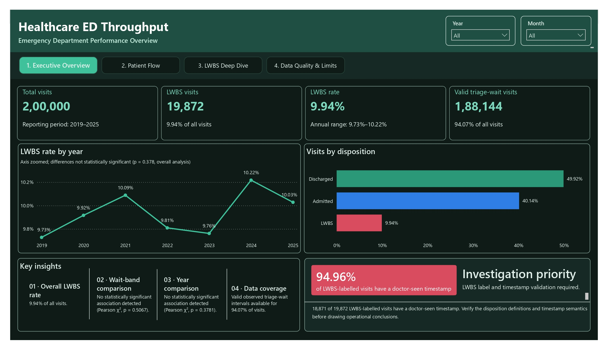
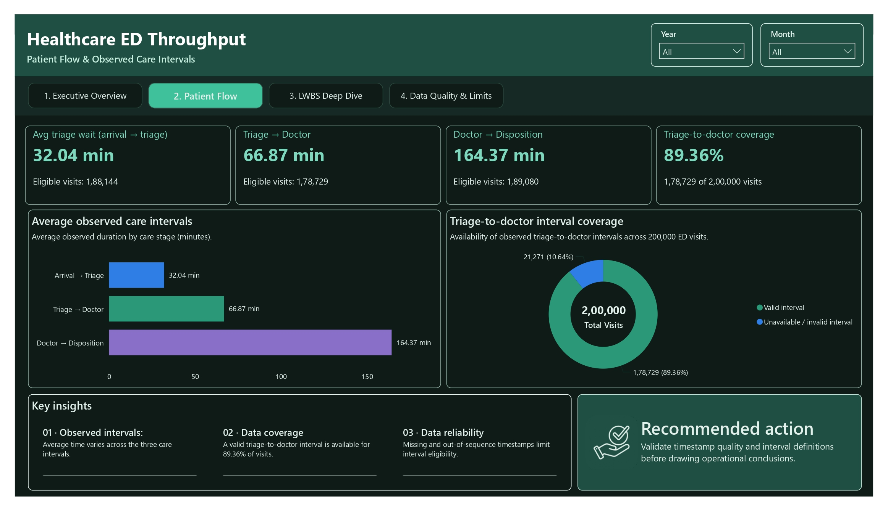
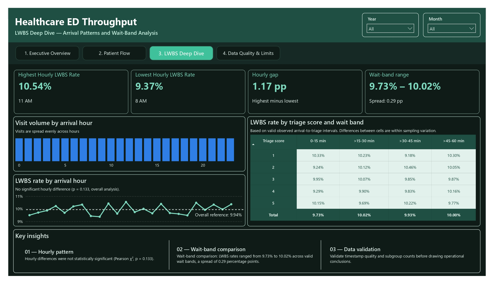
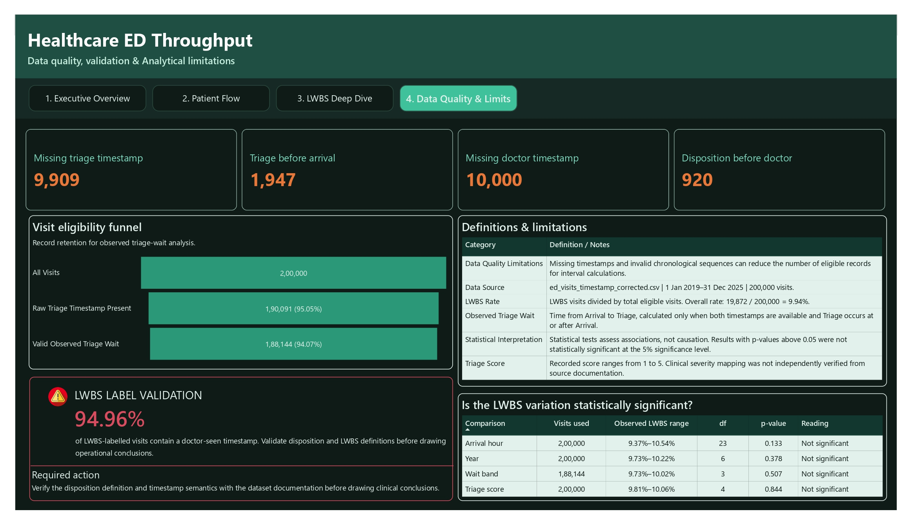

# Healthcare ED Throughput Optimization

An end-to-end healthcare analytics project examining emergency department (ED) patient flow, Left Without Being Seen (LWBS) patterns, timestamp quality, and operational reporting limitations using **SQL Server, Python, and Power BI**.

The project demonstrates data validation, timestamp-based KPI development, statistical analysis, SQL–Power BI reconciliation, and responsible interpretation of healthcare data.

> **Data transparency:** The original dataset source and redistribution license have not been verified. The dataset may be simulated. Findings should therefore be interpreted as an analytical demonstration, not as evidence of real-world hospital performance.

## Table of Contents

- [Business Problem](#business-problem)
- [Business Questions](#business-questions)
- [Project Objectives](#project-objectives)
- [Dataset Overview](#dataset-overview)
- [Tools and Technologies](#tools-and-technologies)
- [Repository Structure](#repository-structure)
- [Methodology](#methodology)
- [Key Findings](#key-findings)
- [Statistical Analysis](#statistical-analysis)
- [Power BI Dashboard](#power-bi-dashboard)
- [SQL and Power BI Reconciliation](#sql-and-power-bi-reconciliation)
- [How to Reproduce](#how-to-reproduce)
- [Limitations](#limitations)
- [Future Improvements](#future-improvements)
- [Author](#author)

## Business Problem

Emergency departments need reliable information about patient flow, waiting intervals, and patients who leave before being seen.

This project develops an analytical workflow to examine recorded visit timestamps, measure valid care intervals, explore LWBS patterns, and identify data-quality limitations that affect interpretation.

The objective is to demonstrate how SQL Server, Python, and Power BI can work together to produce traceable and transparent healthcare analytics.

## Business Questions

1. What proportion of recorded visits is classified as LWBS?
2. How does the recorded LWBS rate vary by arrival year and hour?
3. How does LWBS vary across observed triage-wait bands and recorded triage scores?
4. How much of the available timestamp data supports valid care-interval calculations?
5. What data-quality and classification limitations should decision-makers consider?

## Project Objectives

- Validate visit records and timestamp quality.
- Calculate observed care intervals from recorded timestamps.
- Measure overall and time-based LWBS patterns.
- Examine LWBS across observed wait bands and recorded triage scores.
- Apply statistical tests to selected categorical comparisons.
- Build an interactive Power BI dashboard with transparent KPI eligibility counts.
- Reconcile SQL results with Power BI measures.
- Document analytical limitations without making unsupported clinical or causal claims.

## Dataset Overview

| Attribute | Description |
|---|---|
| Recorded ED visits | 200,000 |
| Distinct patients | 49,059 |
| Arrival date range | January 2019 – December 2025 |
| Disposition categories | Discharged, Admitted, LWBS |
| Primary analysis unit | Visit |
| Repeated observations | Multiple visits may belong to the same patient |

The dataset contains multiple visits for some patients. Patient-level clustering is considered in the exploratory GEE analysis.

**Data provenance:** The original source and redistribution license have not been verified. The dataset may be simulated, and its findings should not be generalized to actual hospital operations.

## Tools and Technologies

- **SQL Server:** Data validation, timestamp interval calculations, analytical views, and reconciliation queries.
- **Python:** Data preparation and statistical analysis using Pandas, SciPy, and Statsmodels.
- **Power BI:** Interactive dashboards, KPI reporting, patient-flow analysis, and data-quality reporting.
- **Jupyter Notebook:** Reproducible statistical analysis and documentation.

## Repository Structure

```text
healthcare-ed-throughput/
│
├── README.md
├── LWBS_significance_tests.ipynb
│
├── docs/
│   ├── ed_visits_timestamp_corrected.csv
│   ├── lwbs_significance_results.csv
│   └── lwbs_statistical_validation.csv
│
├── report/
│   └── Healthcare_ED_Final_Analytics.pbix
│
├── screenshots/
│   ├── executive-overview.jpg
│   ├── patient-flow.jpg
│   ├── lwbs-deep-dive.jpg
│   └── data-quality-limits.jpg
│
└── sql/
    └── Healthcare_ED_Final_Analytics.sql
```

> The repository currently contains a patient-level CSV export. Before making the repository public, verify the dataset's source, redistribution permission, and whether the identifiers or other fields could expose sensitive information. Do not publish unauthorized or sensitive patient-level data.

## Methodology

### 1. Data Validation

SQL and Python checks examine:

- Total visit rows and distinct visit IDs.
- Distinct patient IDs.
- Missing timestamps and analysis fields.
- Chronological inconsistencies between recorded events.
- Disposition counts.
- Duplicate visit identifiers.

### 2. Timestamp-Based Care Intervals

Care intervals are calculated from recorded timestamps. Invalid or unavailable intervals are excluded from the corresponding average rather than treated as zero.

| Care interval | Eligibility rule |
|---|---|
| Arrival → Triage | Both timestamps exist and triage is not before arrival |
| Triage → Doctor | Required timestamps exist and follow valid chronological order |
| Doctor → Disposition | Both timestamps exist and disposition is not before doctor seen |
| Arrival → Disposition | Both timestamps exist and disposition is not before arrival |

Each interval has its own eligible visit count. Therefore, the averages do not necessarily represent the same set of visits.

**Interpretation note:** Doctor-to-disposition duration is not a validated boarding-time measure.

### 3. LWBS Analysis

The analysis examines recorded LWBS classifications by:

- Arrival year.
- Arrival hour.
- Observed triage-wait band.
- Recorded triage score.
- Combined triage-score and wait-band categories.

### 4. Statistical Analysis

The notebook contains two distinct statistical workflows.

**Exploratory analysis — Section 10**

- Patient-clustered Generalized Estimating Equations (GEE) with a binomial family and exchangeable working correlation.
- Pearson chi-square test for wait-band comparison.
- Mann–Whitney U test comparing observed wait-time distributions.
- The exploratory wait-time analysis uses the full prepared dataset, including zero-minute wait values.

**Final consolidated validation — Section 12**

- Pearson chi-square tests for triage score, arrival year, arrival hour, and wait band.
- Mann–Whitney U test comparing LWBS and non-LWBS wait-time distributions.
- Wait-time analyses use records with observed wait time greater than zero.
- The resulting sample contains 188,144 valid wait-time records.

The two workflows use different methods and wait-time eligibility rules. Their results are therefore reported separately. The Power BI statistical summary uses the final consolidated validation results from Section 12.

## Key Findings

### Overall LWBS

| Metric | Result |
|---|---:|
| Total recorded visits | 200,000 |
| LWBS-classified visits | 19,872 |
| Overall LWBS rate | 9.94% |

Approximately one in ten recorded visits is classified as LWBS in this dataset.

### Observed Care Intervals

| Care interval | Eligible visits | Average duration |
|---|---:|---:|
| Arrival → Triage | 188,144 | 32.04 minutes |
| Triage → Doctor | 178,729 | 66.87 minutes |
| Doctor → Disposition | 189,080 | 164.37 minutes |

These averages apply only to visits eligible for each interval calculation.

### LWBS Patterns

| Analysis | Observed result |
|---|---:|
| Highest hourly LWBS rate | 10.54% at 11 AM |
| Lowest hourly LWBS rate | 9.37% at 8 AM |
| Hourly rate spread | 1.17 percentage points |
| Wait-band LWBS rate range | 9.73%–10.02% |
| Wait-band rate spread | 0.29 percentage points |
| Annual LWBS rate range | 9.73%–10.22% |

These are descriptive differences and should not be interpreted as evidence of statistically significant differences.

## Statistical Analysis

### Final Consolidated Validation — Section 12

| Comparison | N | Statistic | df | p-value |
|---|---:|---:|---:|---:|
| Triage Score vs LWBS | 200,000 | 1.4002 | 4 | 0.844160 |
| Arrival Year vs LWBS | 200,000 | 6.4177 | 6 | 0.378063 |
| Arrival Hour vs LWBS | 200,000 | 30.6157 | 23 | 0.132529 |
| Wait Band vs LWBS | 188,144 | 2.3306 | 3 | 0.506682 |
| Valid wait time: LWBS vs non-LWBS | 188,144 | 1,591,636,000* | — | 0.259916 |

*The Mann–Whitney U statistic is displayed rounded, as in the exported validation output.*

At the 0.05 significance level, none of these final tests detected a statistically significant difference.

This does not establish that the groups are identical or that the examined factors have no effect. It indicates that statistically significant differences were not detected by these tests.

### Exploratory Analysis — Section 10

| Comparison | Statistic | df | p-value |
|---|---:|---:|---:|
| Triage Score vs LWBS (GEE) | 1.389978 | 4 | 0.845935 |
| Wait Band vs LWBS (GEE) | 1.856430 | 3 | 0.602733 |
| Wait Band vs LWBS (Pearson) | 1.856527 | 3 | 0.602712 |
| Arrival Year vs LWBS (GEE) | 6.420616 | 6 | 0.377757 |
| Arrival Hour vs LWBS (GEE) | 30.854285 | 23 | 0.126415 |
| Wait Distribution: LWBS vs non-LWBS | — | — | 0.316247 |

The exploratory workflow also found no statistically significant results at the 0.05 level.

## Data Quality Assessment

| Data-quality check | Count |
|---|---:|
| Missing triage timestamp | 9,909 |
| Triage before arrival | 1,947 |
| Missing doctor-seen timestamp | 10,000 |
| Disposition before doctor seen | 920 |
| Valid arrival-to-triage intervals | 188,144 (94.07%) |
| Valid triage-to-doctor intervals | 178,729 (89.36%) |

These conditions may overlap and should not be added together to estimate a total number of affected visits.

### LWBS Classification Consistency

Of the 19,872 visits classified as LWBS, 18,871 (94.96%) have a recorded doctor-seen timestamp.

This is a classification-consistency concern requiring investigation. The available data does not establish whether the timestamp or disposition label is incorrect.

Disposition definitions should be verified with the data owner before using these records for operational decisions.

## Power BI Dashboard

The Power BI report contains four analytical pages.

### 1. Executive Overview

Presents overall visit volume, LWBS rate, yearly trends, and disposition mix.



### 2. Patient Flow

Presents observed care intervals, average durations, eligible visit counts, and interval coverage.



### 3. LWBS Deep Dive

Examines LWBS patterns by arrival hour, observed triage-wait band, and recorded triage score.



### 4. Data Quality & Limits

Summarizes timestamp-quality issues, interval eligibility, LWBS classification consistency, and statistical limitations.



## SQL and Power BI Reconciliation

The SQL interval results match the reported Power BI values when the same eligibility rules are applied.

| Interval | SQL eligible count | SQL average | Power BI average |
|---|---:|---:|---:|
| Arrival → Triage | 188,144 | 32.04 min | 32.04 min |
| Triage → Doctor | 178,729 | 66.87 min | 66.87 min |
| Doctor → Disposition | 189,080 | 164.37 min | 164.37 min |

Reconciliation should be repeated whenever SQL definitions or Power BI measures change.

## How to Reproduce

### Prerequisites

- SQL Server 2016 or later.
- SQL Server Management Studio.
- Power BI Desktop.
- Python and Jupyter Notebook.
- Python packages: Pandas, NumPy, SciPy, and Statsmodels.

### Step 1: Prepare the Database

Create or select the `Healthcare_Project` database and load the source table as `dbo.Cleaned_ED_Visits`.

The source schema must contain the visit, patient, timestamp, disposition, and triage-score fields referenced by the SQL script.

### Step 2: Run the SQL Script

1. Open `sql/Healthcare_ED_Final_Analytics.sql` in SQL Server Management Studio.
2. Confirm the database name and source table.
3. Execute the script.
4. Review the validation outputs and analytical views.
5. Verify the interval counts and averages.

### Step 3: Prepare the Statistical Analysis

Export the required columns from the analytical view:

```sql
SELECT
    Visit_ID,
    Patient_ID,
    Arrival_Timestamp,
    Disposition_Type,
    Observed_Triage_Wait_Minutes,
    Triage_Score
FROM dbo.vw_Observed_Visit_Intervals;
```

Place the approved dataset at:

`docs/ed_visits_timestamp_corrected.csv`

The notebook uses a project-relative path:

```python
from pathlib import Path

PROJECT_ROOT = Path.cwd()
FILE_PATH = PROJECT_ROOT / "docs" / "ed_visits_timestamp_corrected.csv"
```

Open `LWBS_significance_tests.ipynb` from the project root and execute the notebook cells in order.

### Step 4: Open the Power BI Report

1. Open `report/Healthcare_ED_Final_Analytics.pbix`.
2. Configure the data source connection for your environment.
3. Refresh the report.
4. Compare interval measures and eligible counts against the SQL results.

### Step 5: Validate the Final Outputs

Confirm that:

- Notebook results match the documented statistical outputs.
- SQL interval counts and averages match Power BI.
- Screenshots represent the final dashboard version.
- README figures match the final validation outputs.

## Limitations

- The original dataset source and license have not been verified.
- The dataset may be simulated and may not represent real emergency department operations.
- Missing and out-of-sequence timestamps limit eligible observations for interval calculations.
- The LWBS label and doctor-seen timestamp combination requires clarification.
- Triage-score meanings and direction have not been independently confirmed.
- Arrival-to-disposition duration is not validated as boarding time.
- Bed occupancy cannot be established from visit counts alone.
- Staffing effects, revenue loss, and causal improvements have not been estimated.
- Statistical non-significance does not establish equivalence or the absence of an effect.

The findings should be treated as a demonstration of analytical methods and reporting practices rather than clinical or operational recommendations.

## Future Improvements

- Obtain a dataset with a verified source, license, and documented field definitions.
- Confirm the meaning of triage scores and disposition categories.
- Investigate the LWBS classification consistency concern.
- Validate timestamp definitions and interval eligibility with subject-matter experts.
- Add appropriate staffing, bed, and capacity data before investigating those operational questions.
- Repeat the analysis using verified real-world data and assess whether findings generalize.

## Author

**Prasobh R.**

Data Analyst | SQL Server | Power BI | Python

- [GitHub](https://github.com/prasobh-r)
- [LinkedIn](https://linkedin.com/in/prasobh04)
- [Portfolio](https://prasobh-r.github.io/portfolio-website/)
