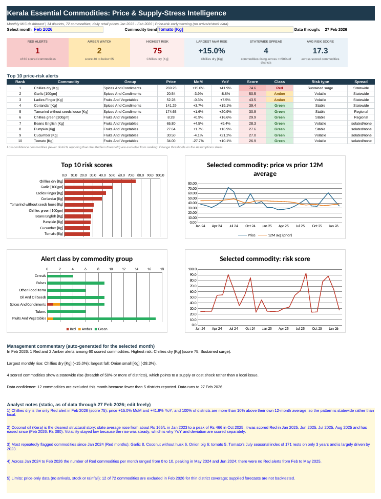
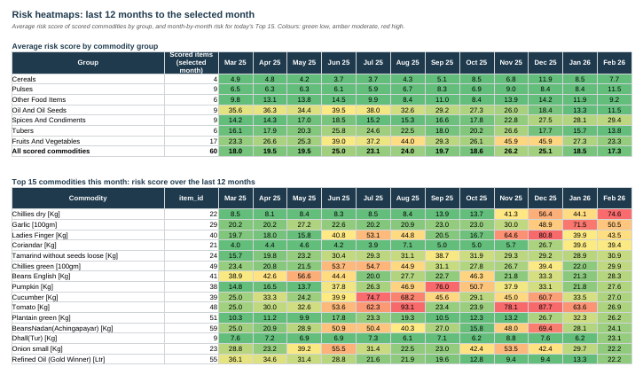

# Kerala Essential Commodities: Price & Supply-Stress Intelligence

An Advanced Excel / MIS reporting project that turns **700K+ daily retail price records** (14 Kerala districts, 72 essential commodities, January 2023 to February 2026) into a monthly **price-risk early-warning pack**: a composite risk index, an exception report, district comparisons, commodity-group trends and a one-page dashboard.



**Contents:** [Quick start](#quick-start) · [Business question](#business-question) · [Key findings](#key-findings-data-through-27-february-2026) · [Data source and attribution](#data-source-and-attribution) · [Method](#method-in-brief) · [Validation](#validation) · [Reproduce](#reproduce) · [Limitations](#limitations) · [Repository layout](#repository-layout)

## Quick start

1. Open `Kerala_Commodity_Price_Risk_MIS.xlsx` and go to the **Dashboard** sheet.
2. Pick a reporting month in the yellow cell (C4) and a commodity for the trend charts (G4).
3. Read the KPI cards and the Top 10 alerts; open **Watchlist** for the full exception report with suggested actions.
4. Use **Group_Heatmap** and **District_View** for trends and district comparisons; change scoring settings on **Assumptions**.

## Business question

Which essential commodities and districts show the strongest signs of price pressure, and where should analysts focus attention to catch potential price spikes and supply-related stress early?

The risk score is an **early-warning indicator based on prices only**. It is not a shortage forecast.

## Key findings (data through 27 February 2026)

- **Feb 2026:** dry chillies is the only Red alert (score about 75): price **+15.0% month on month** and **+41.9% year on year**, and all 14 districts are more than 10% above their own 12-month averages, a statewide pattern. Garlic and Ladies Finger are Amber. 60 of 72 commodities are scored; 12 are excluded for thin district coverage.
- **Coconut oil (Kera)** rose from about Rs 165/L (Jan 2023) to a peak of about Rs 466 (Oct 2025) and was Red in Jan 2025 and Jun to Aug 2025, before easing to about Rs 380. Its volatility stayed low because the rise was steady, which is why year-on-year change and deviation from the 12-month average are scored separately from volatility.
- **Most repeatedly flagged (Red months, Jan 2024 to Feb 2026):** garlic 8, coconut sold per 10 nos 6, onion big 6, tomato 5.
- Red commodities per month ranged from 0 to 10, peaking in May and Jun 2024; there were no Red alerts from Feb to May 2025.



## Data source and attribution

**Official sources (Department of Economics and Statistics, Government of Kerala):**

1. [Essential Commodity Price Dataset (dataset 67)](https://ecostat.kerala.gov.in/dataset/67)
2. [State Dashboard: Prices of Essential Commodities](https://ecostat.kerala.gov.in/state-dashboard-prices-of-essential-commodities?lang=mal) (Malayalam version of the page)

The dashboard describes daily retail prices of essential food commodities collected at the 14 district headquarters on working days. When data is unavailable for a day, the dashboard is described as showing the last available day's data. *Accessed: TODO add date.*

**Coverage:** 3 Jan 2023 to 27 Feb 2026 | 14 districts | 70 commodities in 2023 and 72 from 2024 | 874 reporting dates (working-day reporting, so a calendar date without records is not automatically missing data).

**Data preparation:** the yearly source files (2023 to 2026) were cleaned into `data/fact_daily_prices_clean.csv` with commodity, district and date dimensions; checks for missing, duplicate and non-positive prices; coverage checks; daily-to-monthly aggregation.

**Attribution:** source data belongs to the Department of Economics and Statistics, Government of Kerala. The cleaning, risk scoring, workbook and documentation in this repository are independent work; they are not official statistics and are not endorsed by the Department.

| Source file | Records | Districts | Commodities | Missing prices | Low-coverage days |
|---|---:|---:|---:|---:|---:|
| 2023 | 220,899 | 14 | 70 | 0 | 0 |
| 2024 | 220,689 | 14 | 72 | 0 | 5 |
| 2025 | 225,092 | 14 | 72 | 0 | 2 |
| 2026 (to 27 Feb) | 35,268 | 14 | 72 | 0 | 2 |
| **Total** | **701,948** | | | **0** | **9** |

"Low-coverage days" are flagged in the source quality report (`data/data_quality_report.csv`); the file does not document the threshold. Zero duplicate (date, district, commodity) rows and zero non-positive prices were found. All 14 districts appear in every year, but coverage varies by commodity (some are reported by only 1 to 3 districts). Full log: [docs/DATA_QUALITY_LOG.md](docs/DATA_QUALITY_LOG.md).

## Method in brief

A **0 to 100 risk score** is the weighted average of seven component scores, each `MIN(1, value / cap) x 100`, measuring **upward** price pressure: price momentum (20%), volatility (15%), deviation from the 12-month average (20%), year-on-year change (15%), district dispersion (10%), breadth of rise across districts (10%) and seasonal pressure (10%). **Red** is 65 or above, **Amber** 40 or above, otherwise **Green**. Commodities reported by fewer than 5 districts are excluded from ranking, not scored zero. Weights, caps and thresholds are inputs on the `Assumptions` sheet.

District dispersion and breadth of rise are price-based proxies for supply stress; they do not measure shortages directly. Full detail: [docs/METHODOLOGY.md](docs/METHODOLOGY.md). Sheet-by-sheet guide: [docs/WORKBOOK_GUIDE.md](docs/WORKBOOK_GUIDE.md).

## Validation

Checked:

- **Risk scores:** the scoring was implemented independently in Excel formulas and in pandas. All 1,560 scored commodity-months match (maximum score difference about 2e-13; no class, risk-type or spread-signal mismatches).
- **Reporting sheets:** 112 District_View cells, 96 Group_Heatmap cells and the Watchlist Top 15 order for Feb 2026 match the pandas results; switching month and commodity (Aug 2025) reproduced the expected rankings.
- **Recalculation:** about 120,000 formulas recalculated in LibreOffice with zero errors.
- **Monthly aggregation:** recomputed monthly averages vs `archive/monthly_price_changes.csv`: median difference 0.02%, 95th percentile 0.23%, maximum 4.7% (a commodity reported by two districts).

Not done: a backtest of the supplied forecasts, and a test of whether high scores precede later price spikes.

## Reproduce

**Option A: Jupyter notebook (step by step)**

```bash
pip install -r requirements.txt
jupyter lab          # open notebooks/Kerala_Commodity_Risk_Pipeline.ipynb, then Run > Run All Cells
```

**Option B: scripts**

```bash
python scripts/01_prepare_monthly.py      # must run first: writes build/*.pkl
python scripts/02_validate_monthly.py     # optional cross-check
python scripts/03_build_workbook.py       # writes build/Kerala_Commodity_Price_Risk_MIS_rebuilt.xlsx
```

On Windows PowerShell, create and activate a virtual environment first: `python -m venv .venv` then `.\.venv\Scripts\Activate.ps1`. Rebuilt workbooks are written to `build/` so the committed workbook is never overwritten (set `MIS_OUT` to choose another path). A script-built workbook has no cached values and is set to calculate when opened in Excel; recalculate with LibreOffice before previewing it elsewhere. Tested with Python 3.12, pandas 3.0.2, numpy 2.4.4, openpyxl 3.1.5.

## Limitations

1. **Price data only.** No market arrivals, stock, rainfall or import data, so supply stress is inferred from price-based proxies.
2. **Possible carried-forward prices.** 88.9% of daily prices equal the previous record for the same district and commodity (no single date exceeds 94.5%, so there are no whole-day copies). Retail prices are sticky, but if the source repeats the last available day, some values may be stale; this cannot be separated from genuinely unchanged prices. Monthly means dampen the effect.
3. **Uneven coverage.** Some commodities are reported by few districts; 12 of 72 are excluded in Feb 2026. Commodity coverage also changes slightly between years (70 to 72).
4. **Analyst-defined weights, caps and thresholds**, calibrated on 2024 to Feb 2026 data. Test sensitivity before operational use.
5. **Short seasonal history** (3 years): for example, tomato's July peak is largely driven by 2023.
6. **Forecasts are indicative scenarios.** They cover only Tomato, Ladies Finger and Coconut oil (Kera), their method is undocumented and they have not been backtested. Tomato's forecast starts 24.4% above its last 30 observations.
7. **Monthly aggregates in the workbook** for speed; a full 700K-row Power Pivot model must be built separately (see the `Model_Guide` sheet). Drop-downs replace slicers.
8. Source commodity groups are kept as supplied (for example, onion small sits under Spices and Condiments).

**Next steps:** backtest the forecasts, add arrivals and rainfall data, add district-level risk scores, and build the Power Pivot model with DAX and slicers.

## Repository layout

```
.
├── Kerala_Commodity_Price_Risk_MIS.xlsx   # main deliverable (already recalculated)
├── data/                                  # 9 input files used by the workbook
├── archive/                               # earlier outputs kept for transparency (superseded or cross-check; not inputs)
├── notebooks/
│   └── Kerala_Commodity_Risk_Pipeline.ipynb
├── scripts/
│   ├── monthly_aggregation.py             # shared daily -> monthly logic
│   ├── 01_prepare_monthly.py
│   ├── 02_validate_monthly.py
│   ├── 03_build_workbook.py
│   └── risk_score.py                      # pandas replica of the scoring logic
├── docs/
│   ├── METHODOLOGY.md
│   ├── WORKBOOK_GUIDE.md
│   ├── DATA_DICTIONARY.md
│   ├── DATA_QUALITY_LOG.md
│   ├── Dataset_Usage.xlsx
│   └── screenshots/
├── build/                                 # generated files (git-ignored)
├── requirements.txt
└── .gitignore
```

## Author and licence

Prasobh R. Code licence: TODO choose one (for example MIT). Source data remains subject to the terms of the Department of Economics and Statistics, Government of Kerala; confirm them before redistributing the data files.
