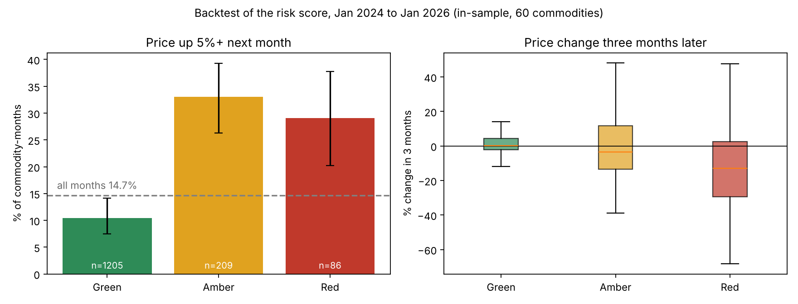

# Backtest of the risk score

**Question.** When a commodity is flagged Red or Amber in a month, does its price tend to rise afterwards?

**Short answer.** Partly. Red and Amber flags are followed by a 5% or larger price rise next month about twice as often as average, and Green flags less often. But most of that signal comes from the fact that some commodities are simply volatile: a rule that only looks at how often a commodity rose 5% in the past gives almost the same result. Within one commodity, the score hardly times the rises, and three months after a Red flag the price is usually lower, not higher. So the score is best read as **a flag for commodities in a price spike now**, not as a forecast of further rises.

Reproduce: `python scripts/04_backtest_risk_score.py` (about 30 seconds; writes `backtest/*.csv` and `docs/screenshots/backtest.png`).

## Design

| Item | Choice |
|---|---|
| Sample | 1,500 scored commodity-months, Jan 2024 to Jan 2026 (60 commodities). Feb 2026 is scored but has no next month. |
| Signal | The published risk score and class (Red 65 or more, Amber 40 or more, Green), unchanged. |
| Main outcome | Price rises 5% or more from month t to month t+1. Base rate: **14.7%**. Windows do not overlap across months. |
| Secondary outcome | Price change from t to t+3. These windows overlap, so it is descriptive, not a test. |
| Baselines | (a) base rate; (b) volatility component alone; (c) the commodity's own share of 5% monthly rises in the previous 12 months; (d) last month's price change. |
| Uncertainty | 95% intervals from a bootstrap that resamples whole commodities (months of one commodity are not independent). Seed fixed. |
| Event size | 5% was my choice; 3% and 10% are shown below so the result does not hang on one threshold. |

## Results

### 1. Next-month rise of 5% or more, by alert class

| Class | Commodity-months | Commodities | Rise of 5%+ next month | 95% interval | vs 14.7% base |
|---|---:|---:|---:|---|---:|
| Red | 86 | 25 | 29.1% | 20.2% to 37.8% | 2.0x |
| Amber | 209 | 33 | 33.0% | 26.3% to 39.3% | 2.3x |
| Green | 1,205 | 60 | 10.5% | 7.5% to 14.1% | 0.7x |

The ordering Green < Red, Amber holds for event sizes of 3% (Red 37.2%, Amber 37.8%, Green 14.6%) and 10% (14.0%, 21.5%, 6.1%), in 2024 and in 2025 to Jan 2026 separately, with the seasonal weight set to 0, and without the five commodities that were Red most often. Red and Amber are not clearly different from each other (the intervals overlap).

### 2. Three months later

| Class | Commodity-months | Median change after 3 months | Price lower after 3 months |
|---|---:|---:|---:|
| Red | 82 | -12.9% | 70.7% |
| Amber | 195 | -3.4% | 56.9% |
| Green | 1,103 | +0.2% | 45.9% |

High scores mostly mark a price that has already jumped, and many jumps (especially in vegetables) fade within a quarter.

### 3. Does the composite score add anything over simple rules?

| Signal | AUC, all months (95% interval) | AUC within each commodity |
|---|---|---:|
| Composite risk score | 0.762 (0.704 to 0.811) | 0.528 |
| Volatility component only | 0.787 (0.731 to 0.833) | 0.432 |
| Own past frequency of 5% rises | 0.758 (0.701 to 0.801) | 0.433 |
| Momentum component only | 0.702 (0.657 to 0.746) | 0.647 |
| Last month's price change | 0.668 (0.614 to 0.724) | 0.669 |

AUC is the chance that a month followed by a 5% rise scored higher than one that was not (0.5 = no skill). "Within each commodity" compares only months of the same commodity (29 commodities with at least 3 rises and 3 non-rises), which asks whether the score can **time** rises.

- Across all commodities the composite (0.762) is no better than the past-frequency rule (0.758) and below volatility alone (0.787). The score mostly identifies which commodities move a lot.
- Within a commodity the composite scores 0.528, close to chance. Last month's price change does better (0.669), and the momentum component alone (0.647).
- Each month, ranking commodities by score has no reliable skill: average rank correlation with next month's change is 0.03 (t = 0.6, positive in 14 of 25 months). The five highest-scoring commodities each month rose 5%+ in 31.2% of cases, against 27.2% for the five with the highest past frequency of rises.

## What this means for the workbook

1. The Red/Amber alerts do separate a calm basket from a stressed one, and the pattern is stable across the checks above.
2. Describe the score as **current price pressure**, not as a predictor of future spikes. The README, the methodology and the workbook text use that wording; earlier drafts called it an "early-warning indicator", which overstated it.
3. A "Red" commodity is usually after a spike, so the more likely next steps are a plateau or a partial reversal. That is useful for procurement timing, but it is the opposite of "prices will keep rising".
4. The weights are not justified by this test. Do not retune them on this same sample; collect more history first.

## Limits of this backtest

- **In-sample.** Weights, caps and thresholds were calibrated on the same 2024 to Feb 2026 data (see METHODOLOGY section 5). This is a consistency check, not an out-of-sample test. A true test needs data after Feb 2026.
- **Seasonal look-ahead.** The seasonal index is built from all three years. Setting its weight to 0 gives the same picture (AUC 0.764), and the seasonal component alone has no skill (AUC 0.47).
- **Small, clustered Red sample.** 86 Red months from 25 commodities; a few (garlic, coconut, onion, tomato) account for many. Without the five most frequent, Red is 25.0% (n = 56).
- **Monthly state averages only.** A rise within a month that reverses before month end is invisible. Possible carried-forward prices (limitation 2 in the README) may understate volatility.
- **Forecasts not backtested.** `data/forecast_*.csv` hold only future predictions with an undocumented method. A backtest needs a refit of a model at past cut-off dates, which is a separate piece of work.

## Files

| File | Content |
|---|---|
| `scripts/04_backtest_risk_score.py` | The backtest (re-runs aggregation and scoring) |
| `backtest/backtest_by_class.csv` | Table 1 and 2 with intervals |
| `backtest/backtest_event_sensitivity.csv` | 3%, 5%, 10% event sizes |
| `backtest/backtest_auc.csv` | Table 3 |
| `backtest/backtest_monthly_cross_section.csv` | Month-by-month ranking check |
| `backtest/backtest_robustness.csv` | Year split, no seasonal, without top Red commodities |
| `backtest/backtest_panel.csv` | Every scored commodity-month with its outcome, for audit |
