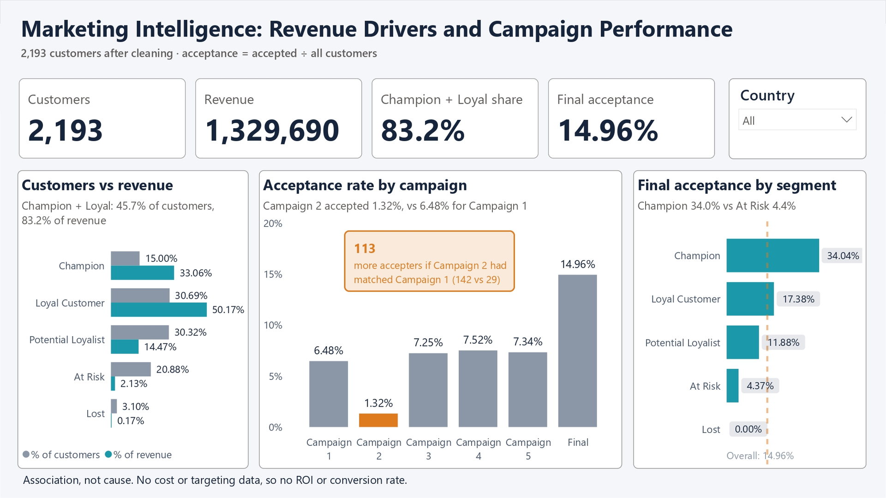
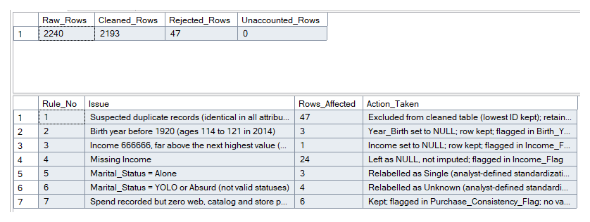
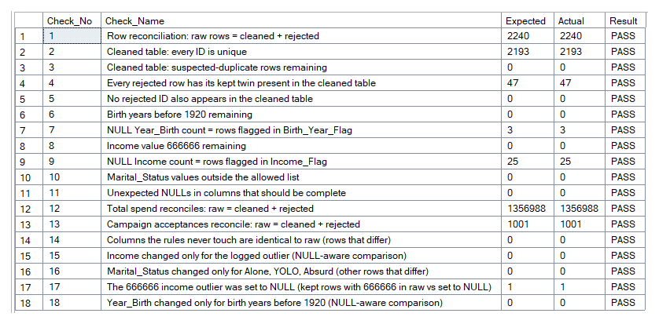
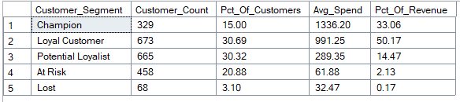
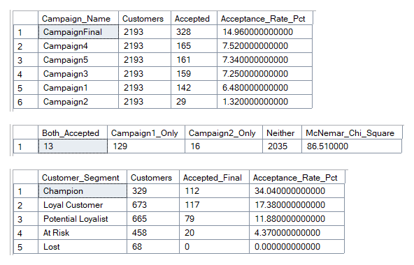
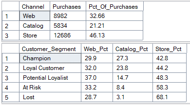
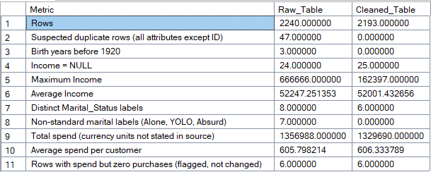
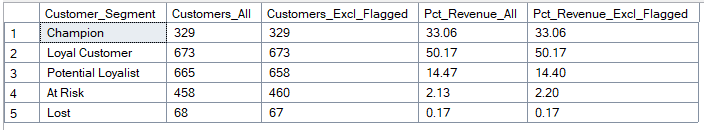
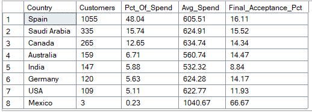

# Marketing Data Quality & Customer Intelligence


> Profile and clean a messy marketing dataset with every decision logged, prove the cleaning with 18 automated checks, then segment customers (RFM) and find out which campaign underperformed and which customers drive revenue.



Interactive file: [`dashboard/Marketing_Intelligence.pbix`](dashboard/Marketing_Intelligence.pbix) (Power BI Desktop). Built on two SQL views from `sql/06_powerbi_views.sql`; the Country slicer filters every visual and subtitle.

## TL;DR for a busy reader

| Question | Answer |
|---|---|
| Who drives revenue? | **Champion + Loyal customers: 45.7% of customers, 83.2% of revenue.** |
| Which campaign underperformed? | **Campaign 2: 1.32% acceptance** vs 6.48% for Campaign 1 (McNemar chi-square 86.5, p < 0.001, same customers). |
| Who responds to the latest campaign? | Champions accept at **34.0%**, At Risk customers at **4.4%**. |
| Where is the money? | 827 customers (37.7%) make 80% of revenue. Wine is about half of all spend. |
| Is the data trustworthy? | 2,240 raw rows, 47 suspected duplicates removed, 2,240 = 2,193 + 47 reconciled, **18/18 validation checks pass**, raw table never modified. |

**Recommended actions** (hypotheses to test, since the data cannot show cause): protect Champion and Loyal customers before broad discounting; review Campaign 2's targeting and offer before reuse; use RFM as a targeting filter and A/B test it; give At Risk customers a low-cost win-back only.

## What this project shows

- **Data quality as a process:** profiling, 7 logged cleaning rules, a rejected-rows table, and a validation suite. Raw data is never changed.
- **Honest analysis:** analyst decisions are labelled as decisions, comparisons are labelled as association, and limitations are listed.
- **BI delivery:** a one-page Power BI dashboard (DAX measures, dynamic subtitles) built on SQL views, with every number reconciled to the SQL results.
- **SQL depth:** CTEs, window functions, `CROSS APPLY` unpivot, dynamic SQL, a star schema with keys, and McNemar's paired test written in T-SQL.

## Repository layout

```
.
├── sql/
│   ├── 01_data_profiling.sql        # read-only checks on the raw table
│   ├── 02_data_cleaning.sql         # cleaned table, rejected rows, cleaning log
│   ├── 03_data_validation.sql       # 18 PASS/FAIL checks + before/after summary
│   ├── 04_star_schema_and_rfm.sql   # star schema, RFM, sensitivity check
│   ├── 05_campaign_analysis.sql     # campaigns, segments, channels, categories, countries
│   └── 06_powerbi_views.sql         # two views that feed the Power BI dashboard
├── dashboard/                       # Power BI file (.pbix) and theme
├── data/                            # source CSV and data dictionary
├── docs/                            # ER diagram, dashboard image
├── screenshots/                     # SQL Server query output for every step
└── README.md
```

## How to run

1. In SSMS, create the database: `CREATE DATABASE MarketingIntelligence;`
2. Import `data/marketing_data.csv` (right-click the database, Tasks, Import Flat File). This creates the raw table `marketing_data`. Confirm with `SELECT COUNT(*) FROM marketing_data` (2,240 rows).
3. Run the scripts in `sql/` in order. Each can be re-run, and none modifies `marketing_data`.
4. Optional: open `dashboard/Marketing_Intelligence.pbix` in Power BI Desktop (it holds a data snapshot; to refresh, point it at your `MarketingIntelligence` database).

Requires SQL Server 2017 or later (`STRING_AGG`). Column definitions: `data/data_dictionary.csv`.

## 1. Business problem

A retail marketing team wants to know which customers are worth targeting and which campaigns underperformed. Before any analysis, the data has to be trustworthy, so the project first profiles and cleans the data with documented decisions, then answers the business questions on the cleaned data.

## 2. Data source

- **Dataset:** Marketing Campaign (Jack Daoud), hosted by [Maven Analytics](https://mavenanalytics.io/data-playground/marketing-campaign-results). Check the source's terms before reusing the CSV.
- **Size:** 2,240 customer records, 28 fields, enrolment dates 2012-07-30 to 2014-06-29.
- **Contents:** demographics, 2-year spend by product category, purchase counts by channel, acceptance of 6 campaigns.
- **Limitations:**
  - No campaign cost data, so ROI and CAC are not calculated.
  - The data does not say who was sent each campaign, so "acceptance rate" = accepted / all customers, not a true conversion rate.
  - Currency is not stated, so amounts are shown as currency units.

## 3. Profiling and cleaning

| Raw-data issue found | Rows | Action |
|---|---|---|
| Suspected duplicates (identical in all attributes except ID) | 47 | Excluded (lowest ID kept), retained in `marketing_rejected` |
| Birth year before 1920 (1893, 1899, 1900) | 3 | Year set to NULL, row kept, flagged |
| Income 666,666 (next highest 162,397) | 1 | Set to NULL, row kept, flagged |
| Missing income | 24 | Left NULL, not imputed, flagged |
| Marital status "Alone" | 3 | Relabelled "Single" |
| Marital status "YOLO" / "Absurd" | 4 | Relabelled "Unknown" |
| Spend recorded with zero purchases | 6 | Kept, flagged, values unchanged |

Rules for duplicates, birth year, the income outlier and "Alone" are **analyst decisions the data cannot prove**. The 1920 limit is a review threshold I chose. Rows are kept wherever possible because age and income are not used in the RFM or campaign analysis.

Missing income is uneven by country: Australia 13 of 160 customers (8.1%), Germany 4 of 120, USA 2 of 109, all others under 1%. Australia against all other countries (13/160 vs 11/2,080) gives Fisher's exact p ≈ 1e-9, and a permutation test that allows for picking the highest country out of all with 100+ customers gives p < 0.001, so the missingness is **not random across countries**. The test shows the pattern, not its cause, which is why income is flagged and not imputed with one overall value (checked outside SQL Server).



## 4. Validation: 18 checks, all PASS

Row reconciliation (2,240 = 2,193 + 47), spend and campaign acceptances reconcile to the raw table, no duplicates remain, untouched columns are identical to raw, and income and birth-year checks use NULL-aware comparisons so a value wrongly turned into NULL would be caught.



| Metric | Raw | Cleaned |
|---|---|---|
| Rows | 2,240 | 2,193 |
| Suspected duplicate rows | 47 | 0 |
| Birth years before 1920 | 3 | 0 |
| Income = NULL | 24 | 25 |
| Maximum income | 666,666 | 162,397 |
| Average income | 52,247 | 52,001 |
| Distinct marital labels | 8 | 6 |
| Total spend | 1,356,988 | 1,329,690 |
| Average spend per customer | 605.80 | 606.33 |

## 5. Data model

Star schema built from the cleaned table: `DimCustomer`, `FactPurchases` (one aggregated row per customer, not transactions) and `FactCampaignResponse` (one row per customer per campaign, 13,158 rows). See [docs/er_diagram.md](docs/er_diagram.md).

## 6. Key findings

### RFM segments
Scored with `NTILE(5)` and a deterministic tie-breaker. Segment cut-offs on the 3 to 15 total are analyst-chosen.

| Segment | Customers | Avg spend | % of revenue | Final-campaign acceptance |
|---|---|---|---|---|
| Champion | 329 (15.0%) | 1,336.20 | 33.06% | 34.04% |
| Loyal Customer | 673 (30.7%) | 991.25 | 50.17% | 17.38% |
| Potential Loyalist | 665 (30.3%) | 289.35 | 14.47% | 11.88% |
| At Risk | 458 (20.9%) | 61.88 | 2.13% | 4.37% |
| Lost | 68 (3.1%) | 32.47 | 0.17% | 0.00% |



Re-running without the 6 inconsistent records left Champion and Loyal unchanged (329 and 673). Because Monetary is one of the three RFM inputs, the revenue share of the top segments is partly built in; the **response gap between segments** is the less circular result. RFM and the final response are measured at the same point in time, so it is an association, not a prediction.

### Campaign performance

| Campaign | Accepted | Rate |
|---|---|---|
| Final | 328 | 14.96% |
| Campaign 4 | 165 | 7.52% |
| Campaign 5 | 161 | 7.34% |
| Campaign 3 | 159 | 7.25% |
| Campaign 1 | 142 | 6.48% |
| Campaign 2 | 29 | 1.32% |

Both campaigns cover the same customers, so Campaign 1 vs 2 uses McNemar's paired test: 129 accepted Campaign 1 only, 16 accepted Campaign 2 only, 13 both, 2,035 neither; chi-square 86.5, p < 0.001.



### Customer value
- Customers who accepted at least one campaign (597) spend 1,002.67 on average vs 458.08 for those who never did (1,596), about 2.19x. There is no control group, so this does not show the campaigns caused the extra spend.
- 827 customers (37.7%) account for 80% of revenue.
- Spend by category: Wines 667,006, Meat 366,920, Gold 96,889, Fish 82,100, Sweets 59,294, Fruits 57,481.

### Channels and countries
- Purchase counts: Store 46.1%, Web 32.7%, Catalog 21.2%. Catalog share is higher in the best segments (Champion 27.3%, Loyal 23.8%, At Risk 8.4%, Lost 3.1%).
- Spain holds 48.0% of spend, in line with its 48.1% of customers; average spend is 532 to 635 in every country with a meaningful sample. India has the lowest final acceptance (8.84%). Mexico has 3 customers, so its figures are not meaningful.



## 7. Recommendations (hypotheses to test)

1. Prioritise retention for Champion and Loyal customers over broad discounting.
2. Review Campaign 2's targeting and offer before reusing it. **Size of the gap:** Campaign 1 reached 142 accepters and Campaign 2 only 29, so matching Campaign 1's 6.48% rate would have meant about **113 more accepters** (assuming the same customers were contacted, which the data does not confirm).
3. Use RFM segment as a targeting filter and test it against the current approach. **Size of the effect:** in the final campaign, Champion and Loyal customers were 45.7% of customers (1,002) but gave 229 of the 328 accepters (69.8%), an acceptance rate of 22.9% against 15.0% overall. Contacting only them would have kept about 7 in 10 accepters with less than half the contacts. This is measured on the same snapshot as the RFM scores, so it needs an A/B test before anyone relies on it.
4. Give At Risk customers a low-cost win-back offer only (4.37% acceptance, 2.13% of revenue).
5. Test catalog-based offers for Loyal customers.
6. Spain is the main market by volume, not because its customers are worth more. Review why India accepts less.

## 8. What this project does not do

- No ROI, CAC or true conversion rate (no cost or targeting data).
- No causal claims about campaigns, channels or segments.
- No imputation of missing income.
- No spend per channel (purchase counts only) and no basket or cross-sell analysis.

## 9. Limitations

- **RFM revenue share is partly built in.** Monetary is one of the three RFM inputs, so top segments holding most of the revenue is expected by construction. The gap in campaign response between segments is the less circular result.
- **Recency looks uniformly generated.** It is spread evenly from 0 to 99 days (about 210 to 230 customers in every 10-day band; Kolmogorov-Smirnov test against a uniform distribution p = 0.22) and is unrelated to spend (r = 0.02) or purchase count (r = 0.00). Real purchase data rarely behaves like that, so the field may be capped or partly synthetic. It still carries signal for the final campaign (r = -0.20; 26.4% acceptance at 24 days or less vs 7.0% at 75 days or more), so the R score is not noise, but findings describe this dataset and may not transfer to a live customer base.
- **Missing income is not random** (see section 3), so any income analysis would need imputation by country, not one overall value.

## 10. More screenshots

| Step | Output |
|---|---|
| Profiling |  |
| Before and after |  |
| RFM sensitivity |  |
| Customer value |  |
| Country view |  |

## Author

Prasobh R · MIT licence (see [LICENSE](LICENSE)).
