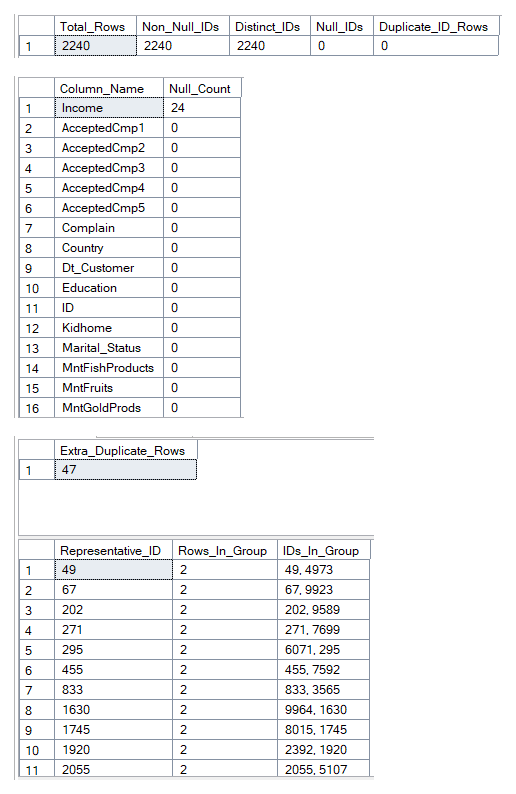
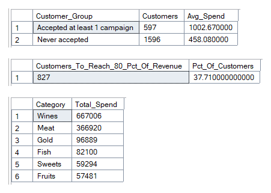

# Marketing Data Quality & Customer Intelligence

SQL Server project: profile and clean a marketing dataset with every decision logged, validate the result against the raw data, then segment customers (RFM) and analyse campaign response.

All figures below come from query output in SQL Server (scripts in `sql/`).

## How to Run
1. Download the dataset from [Maven Analytics](https://mavenanalytics.io/data-playground/marketing-campaign-results).
2. In SSMS, create the database the scripts use: `CREATE DATABASE MarketingIntelligence;`
3. Right-click that database, Tasks, Import Flat File, select the CSV. This creates the raw table `marketing_data`. Run `SELECT COUNT(*) FROM marketing_data` to confirm 2,240 rows.
4. Run the scripts in `sql/` in order. Each one can be re-run, and none modifies `marketing_data`.

| Script | What it does |
|---|---|
| `01_data_profiling.sql` | Read-only checks on the raw table |
| `02_data_cleaning.sql` | Builds `marketing_data_cleaned`, `marketing_rejected` and `data_cleaning_log` |
| `03_data_validation.sql` | 18 PASS/FAIL checks and a before/after summary |
| `04_star_schema_and_rfm.sql` | Star schema and RFM segmentation, with a sensitivity check |
| `05_campaign_analysis.sql` | Campaign, segment, channel, category and country analysis |

Requires SQL Server 2017 or later (`STRING_AGG`). Column definitions are in `data/data_dictionary.csv`.

## 1. Business Problem
A retail marketing team wants to know which customers are worth targeting and which campaigns underperformed. Before any analysis, the data has to be trustworthy, so this project first profiles and cleans the data with documented decisions, then answers the business questions on the cleaned data.

## 2. Data Source
- **Dataset:** Marketing Campaign (Jack Daoud), hosted by Maven Analytics.
- **Size:** 2,240 customer records, 28 fields, enrolment dates from 2012-07-30 to 2014-06-29.
- **Contents:** demographics, 2-year spend by product category, purchase counts by channel, and acceptance of 6 campaigns.
- **Known limitations:**
  - No campaign cost data, so ROI and CAC are not calculated.
  - The data does not say which customers were sent each campaign, so "acceptance rate" means accepted / all customers, not a true conversion rate.
  - The currency of the spend fields is not stated, so amounts are shown as currency units.

## 3. Data Profiling (raw table)
| Check | Result |
|---|---|
| Rows / distinct IDs | 2,240 / 2,240 |
| Suspected duplicates (identical in all attributes except ID) | 47 pairs |
| Implausible birth years | 3 (1893, 1899, 1900) |
| Income outlier | 666,666 (next highest is 162,397) |
| Missing income | 24 |
| Non-standard marital labels | Alone (3), YOLO (2), Absurd (2) |
| Spend recorded with zero purchases | 6 rows |
| Dates | 0 unreadable |
| Negative values, invalid campaign flags | 0 (the column types `tinyint` and `bit` already rule these out) |

Missing income is uneven by country: Australia 13 of 160 customers (8.1%), Germany 4 of 120 (3.3%), USA 2 of 109 (1.8%), all others under 1%. With counts this small it is a lead, not proof.

## 4. Cleaning Decisions
Raw data is never changed. Removed rows are kept in `marketing_rejected`, and `data_cleaning_log` records each rule with counts calculated from the data.

| # | Issue | Rows | Action |
|---|---|---|---|
| 1 | Suspected duplicate records | 47 | Excluded from the cleaned table (lowest ID kept), retained in `marketing_rejected` |
| 2 | Birth year before 1920 | 3 | Year set to NULL, row kept, flagged |
| 3 | Income 666,666 | 1 | Set to NULL, row kept, flagged |
| 4 | Missing income | 24 | Left as NULL, not imputed, flagged |
| 5 | Marital status "Alone" | 3 | Relabelled "Single" |
| 6 | Marital status "YOLO" or "Absurd" | 4 | Relabelled "Unknown" |
| 7 | Spend with zero purchases | 6 | Kept, flagged, values unchanged |

Rules 1, 2, 3 and 5 are analyst decisions the data cannot prove. The 1920 threshold is a review limit I chose, and treating "Alone" as "Single" is an assumption. Rows were kept wherever possible because age and income are not used in the RFM or campaign analysis.

## 5. Validation
18 checks, all PASS, including: raw rows = cleaned + rejected (2,240 = 2,193 + 47), total spend and campaign acceptances reconcile to the raw table, no duplicates remain, and columns the rules never touch are identical to raw. The income and birth-year checks compare against the raw table with NULL-aware logic, so a value wrongly changed to NULL would be caught: only the one 666,666 outlier and the 3 implausible birth years differ from raw.

| Metric | Raw | Cleaned |
|---|---|---|
| Rows | 2,240 | 2,193 |
| Suspected duplicate rows | 47 | 0 |
| Birth years before 1920 | 3 | 0 |
| Income = NULL | 24 | 25 |
| Maximum income | 666,666 | 162,397 |
| Average income | 52,247 | 52,001 |
| Distinct marital labels | 8 | 6 |
| Total spend (currency units) | 1,356,988 | 1,329,690 |
| Average spend per customer | 605.80 | 606.33 |
| Spend with zero purchases (flagged, not changed) | 6 | 6 |

## 6. Data Model
Star schema built from the cleaned table: `DimCustomer`, `FactPurchases` (one aggregated row per customer, not transactions) and `FactCampaignResponse` (one row per customer per campaign, 13,158 rows). See `docs/er_diagram.md`.

## 7. Key Findings
**RFM segments** (scored with `NTILE(5)` and a deterministic tie-breaker):

| Segment | Customers | Avg spend | % of revenue |
|---|---|---|---|
| Champion | 329 (15.0%) | 1,336.20 | 33.06% |
| Loyal Customer | 673 (30.7%) | 991.25 | 50.17% |
| Potential Loyalist | 665 (30.3%) | 289.35 | 14.47% |
| At Risk | 458 (20.9%) | 61.88 | 2.13% |
| Lost | 68 (3.1%) | 32.47 | 0.17% |

Champion and Loyal customers are 45.7% of customers and 83.2% of revenue. Re-running the segmentation without the 6 inconsistent records left both rows unchanged (329 and 673 customers).

**Campaign acceptance (% of all 2,193 customers):**

| Campaign | Accepted | Rate |
|---|---|---|
| Final | 328 | 14.96% |
| Campaign 4 | 165 | 7.52% |
| Campaign 5 | 161 | 7.34% |
| Campaign 3 | 159 | 7.25% |
| Campaign 1 | 142 | 6.48% |
| Campaign 2 | 29 | 1.32% |

Campaign 2 is clearly the weakest. Both campaigns cover the same customers, so the comparison with Campaign 1 uses McNemar's paired test: 129 customers accepted Campaign 1 only, 16 accepted Campaign 2 only, 13 accepted both and 2,035 neither, giving a chi-square of 86.5 (p < 0.001).

**Final campaign acceptance by RFM segment:** Champion 34.04%, Loyal 17.38%, Potential Loyalist 11.88%, At Risk 4.37%, Lost 0.00%. RFM and the final response are measured at the same point in time, so this is an association, not a prediction.

**Responders vs non-responders:** customers who accepted at least one campaign (597) spend 1,002.67 on average against 458.08 for those who never did (1,596), about 2.19 times. There is no control group, so this does not show that campaigns caused the extra spend.

**Revenue concentration:** 827 customers (37.7%) account for 80% of revenue.

**Purchase channels** (counts of purchases): Store 46.1%, Web 32.7%, Catalog 21.2%. Higher-value segments use catalog more: 27.3% of Champion purchases and 23.8% of Loyal purchases, against 8.4% for At Risk and 3.1% for Lost.

**Product categories** (spend): Wines 667,006, Meat 366,920, Gold 96,889, Fish 82,100, Sweets 59,294, Fruits 57,481. Wine spend roughly equals all other categories combined.

**Countries:** Spain has 48.0% of spend, almost the same as its share of customers (48.1%), and average spend is 532 to 635 in every country with a meaningful sample. India has the lowest final acceptance (8.84%). Mexico has only 3 customers, so its figures are not meaningful.

## 8. Recommendations
These are hypotheses to test, because the data cannot show cause.
1. Prioritise retention for Champion and Loyal customers (45.7% of customers, 83.2% of revenue) over broad discounting.
2. Review Campaign 2's targeting and offer before reusing it.
3. Use RFM segment as a targeting filter and test it against the current approach.
4. Give At Risk customers a low-cost win-back offer only; they accept at 4.37% and contribute 2.13% of revenue.
5. Test catalog-based offers for Loyal customers, since catalog use is higher in the best segments.
6. Spain is the main market by volume, not because customers there are worth more. Review why India accepts less.

## 9. What This Project Does Not Do
- No ROI, CAC or true conversion rate (no cost or targeting data).
- No causal claims about campaigns, channels or segments.
- No imputation of missing income.
- No spend per channel (the source has purchase counts only).
- No basket or cross-sell analysis, so product bundling is not tested.

## 10. SQL Techniques Used
CTEs, window functions (`NTILE`, `MIN OVER`, running `SUM OVER`), `CROSS APPLY (VALUES ...)` unpivot, dynamic SQL with `STRING_AGG`, `SELECT INTO`, temp tables, constraints (primary and foreign keys), a computed column, `TRY_CONVERT`, `COALESCE`, and McNemar's paired test written in T-SQL.

## 11. Tech Stack
SQL Server (SSMS), T-SQL.

## 12. Screenshots
Results from SQL Server (`/screenshots`).

**Profiling the raw table** (ID check, NULL counts, duplicate groups; the lists show the first rows only)

**Cleaning: row reconciliation and cleaning log**

**Validation: 18 checks, all PASS**

**Before and after cleaning**

**RFM segments with and without the 6 inconsistent records**

**Campaign acceptance rates, McNemar test and final-campaign response by segment**

**Responders vs non-responders, revenue concentration and category spend**

**Purchase channel mix, overall and by segment**

**Country view**

